<p align="center">
  
  &nbsp;&nbsp;&nbsp;&nbsp;
  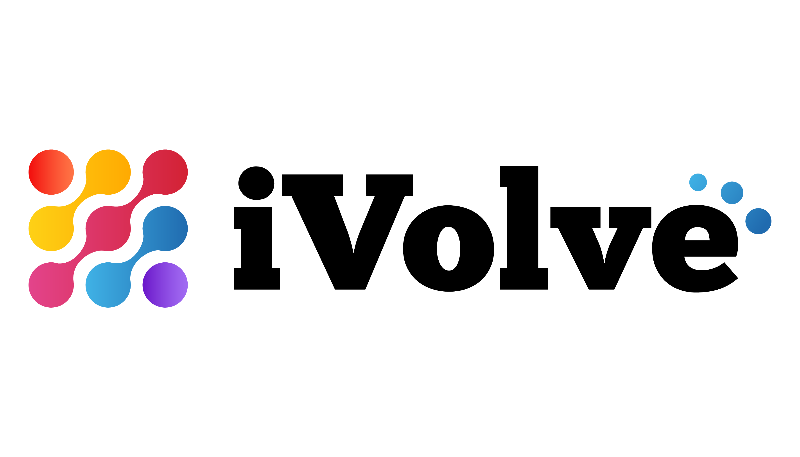
</p>

<h1 align="center">iVolve DevOps Final Project</h1>

<p align="center">
  A three-service web app (login + DevOps roadmap) delivered end to end:<br/>
  Terraform on AWS, Ansible-built Jenkins, Trivy-scanned images in ECR, Argo CD GitOps onto one EKS cluster, Vault secrets, Prometheus/Grafana.
</p>

<p align="center"><a href="https://moaz-elgendy.github.io/ivolve-final-project/">Project site</a> (screenshots, pipeline history, cluster output)</p>

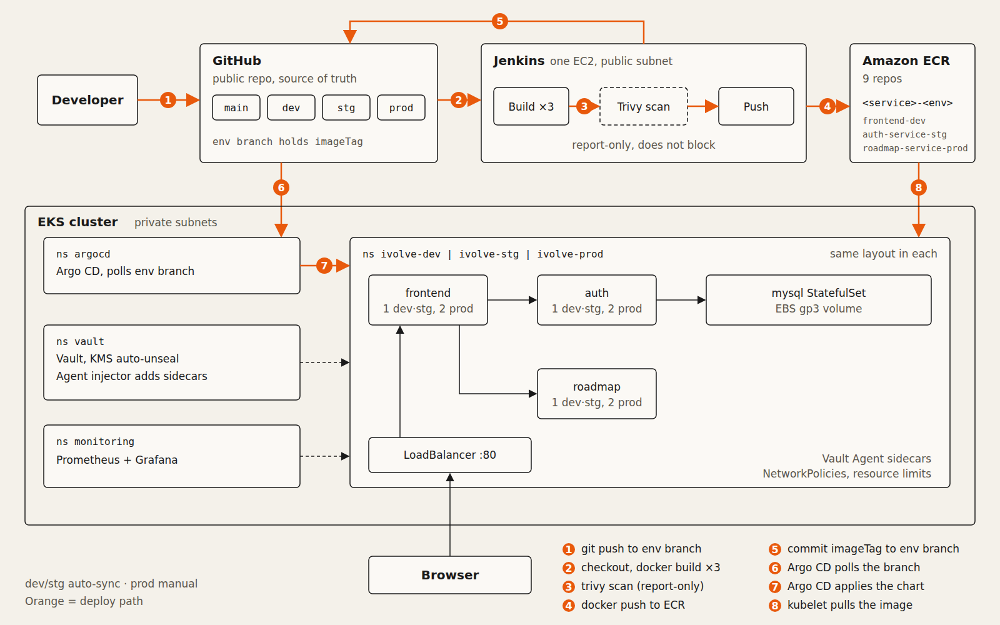

## Stack at a glance

| Layer | Tooling | Folder |
| --- | --- | --- |
| Application | Node.js frontend, Python auth service, Java roadmap service, MySQL | [app/](app/) |
| Infrastructure | Terraform: VPC, 1 EC2, 9 ECR repos, 1 EKS cluster, KMS key; S3 remote state | [terraform/](terraform/) |
| Configuration | Ansible: git, Jenkins, Docker, Trivy on the EC2 host | [ansible/](ansible/) |
| CI | One Jenkins host, one parameterised pipeline (`ENV`), shared library | [Jenkinsfile](Jenkinsfile), [jenkins/](jenkins/) |
| Image scan | Trivy, report-only | [testImage.groovy](jenkins/shared-library/vars/testImage.groovy) |
| CD | Argo CD, one Application per environment | [argo/applications/](argo/applications/) |
| Packaging | Helm chart | [helm/ivolve/](helm/ivolve/) |
| Secrets | HashiCorp Vault, KMS auto-unseal, Agent Injector | [helm/vault/](helm/vault/) |
| Monitoring | kube-prometheus-stack (Prometheus + Grafana) | [helm/monitoring/](helm/monitoring/) |

One of everything shared (VPC, EKS cluster, Jenkins EC2, Argo CD, Vault, monitoring, ECR). Three of everything per environment (dev, stg, prod): git branch, Argo Application, namespace `ivolve-<env>`, 3 ECR repos, Helm values file.

## How it flows

1. A developer pushes code to branch `dev`, `stg` or `prod` and runs the Jenkins pipeline with `ENV` set.
2. Jenkins checks out that branch and sets `IMAGE_TAG` to the build number.
3. Jenkins builds the 3 images and Trivy scans each one (report-only).
4. Jenkins pushes `<service>-<env>:<build>` to ECR using the EC2 instance role.
5. Jenkins rewrites `imageTag` in `helm/ivolve/values-<env>.yaml` and pushes that commit to branch `<env>`.
6. Argo CD sees the commit, renders the chart and applies it to `ivolve-<env>` (auto in dev/stg, manual in prod).

Jenkins never talks to the cluster; git is the source of truth.

## Evidence

Live cluster, 2026-11-22: EKS with 2 nodes (`v1.35.9-eks`, eu-west-1). Namespaces `argocd`, `vault`, `monitoring`, `kube-system` and `ivolve-dev` running.

```text
$ kubectl get pods -n ivolve-dev
NAME                        READY   STATUS    RESTARTS
auth-6b9dc8f9d8-5vjhl       2/2     Running   0
frontend-6fc4f9ffc-lxqn7    2/2     Running   0
mysql-0                     2/2     Running   0
roadmap-6f5785b5f4-fltds    1/1     Running   0
```

The second container on auth, frontend and mysql is the Vault agent sidecar. Roadmap uses no secrets, so it has none. Dev runs 1 replica per service.

<table>
  <tr>
    <td width="50%">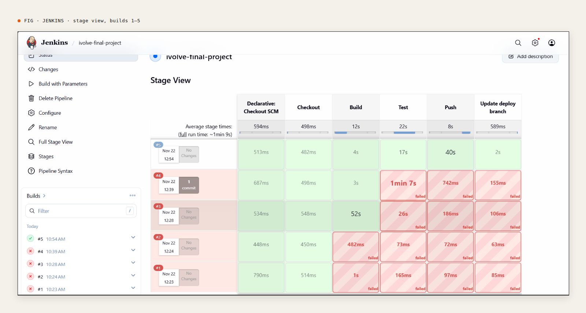<br/>Jenkins: builds #1-#2 failed at Build, #3-#4 at Test, #5 green (about 1 min).</td>
    <td width="50%">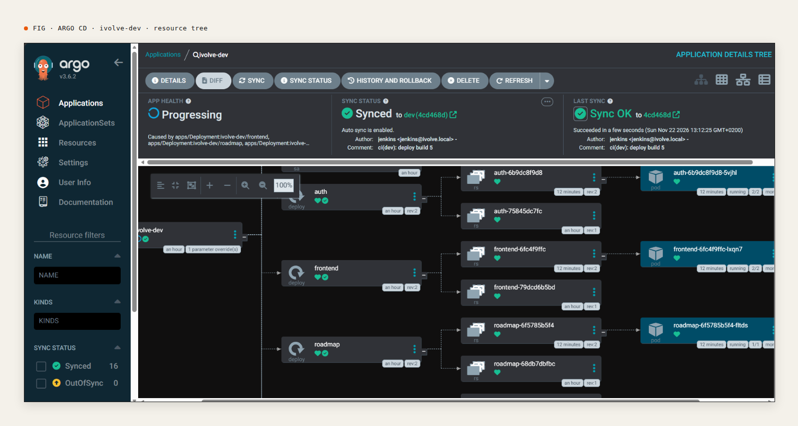<br/>Argo CD: <code>ivolve-dev</code> resource tree, synced to deploy build 5.</td>
  </tr>
  <tr>
    <td>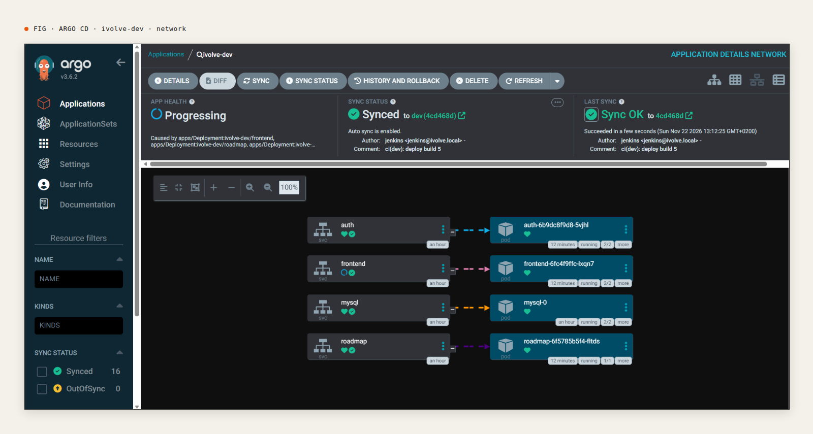<br/>Argo CD network view of <code>ivolve-dev</code>.</td>
    <td>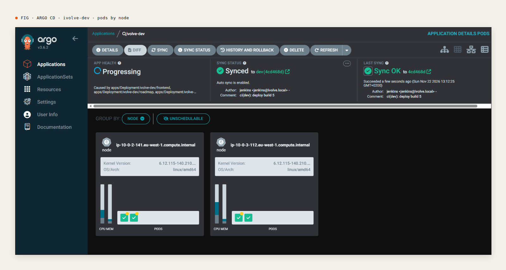<br/>Pods spread across the 2 worker nodes.</td>
  </tr>
  <tr>
    <td>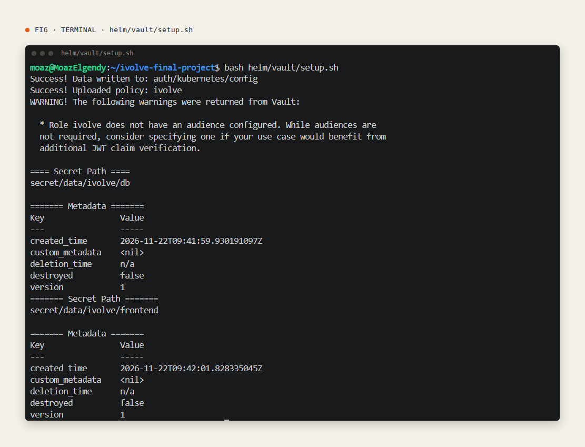<br/><code>helm/vault/setup.sh</code>: Kubernetes auth, policy, KV secrets.</td>
    <td>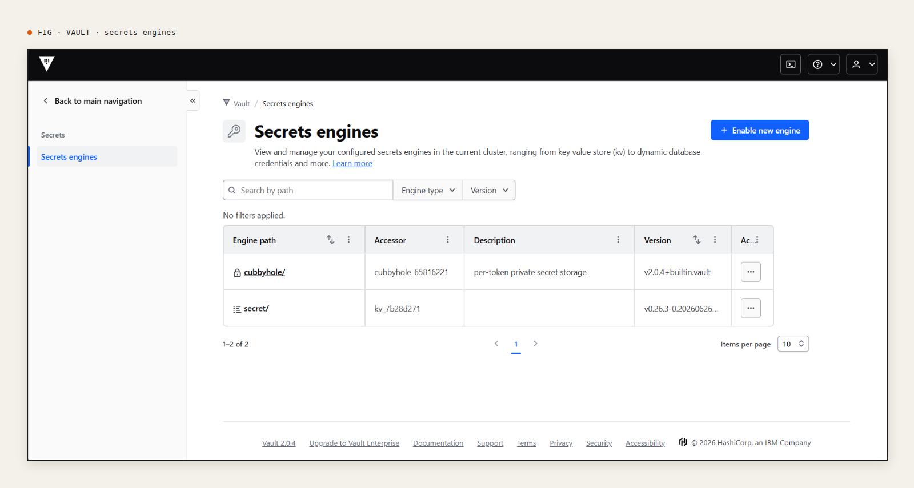<br/>Vault UI: KV v2 at <code>secret/</code>.</td>
  </tr>
  <tr>
    <td>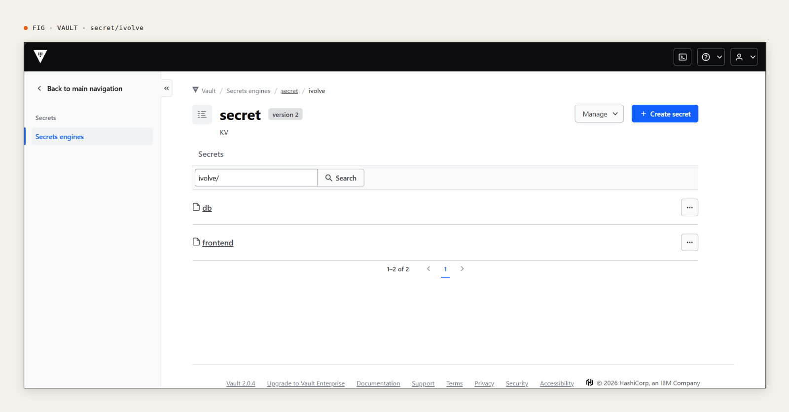<br/>Vault UI: <code>secret/ivolve/db</code> and <code>frontend</code>.</td>
    <td>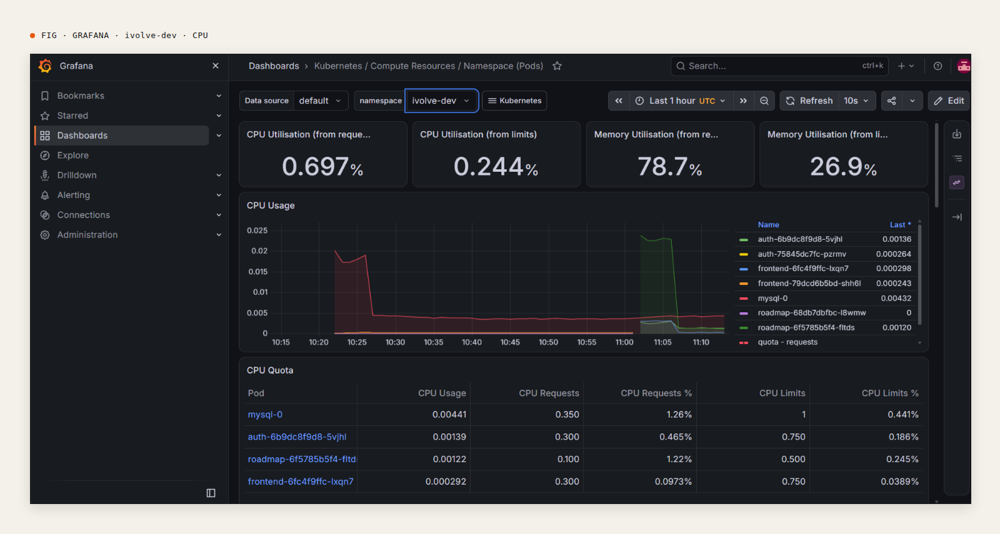<br/>Grafana: CPU per pod in <code>ivolve-dev</code>.</td>
  </tr>
  <tr>
    <td>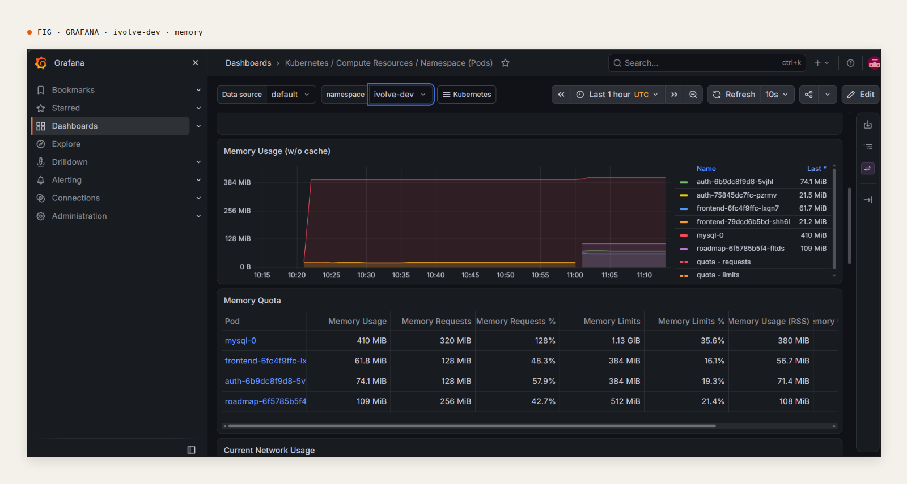<br/>Grafana: memory per pod in <code>ivolve-dev</code>.</td>
    <td>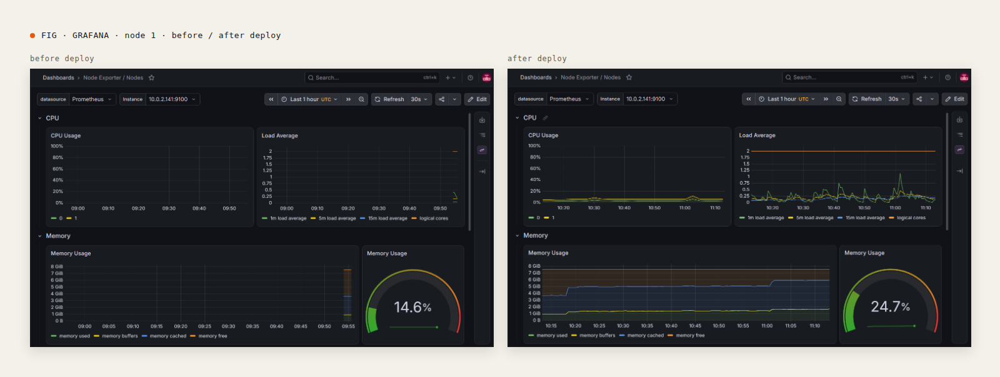<br/>Worker node 1, before and after the app.</td>
  </tr>
  <tr><td colspan="2">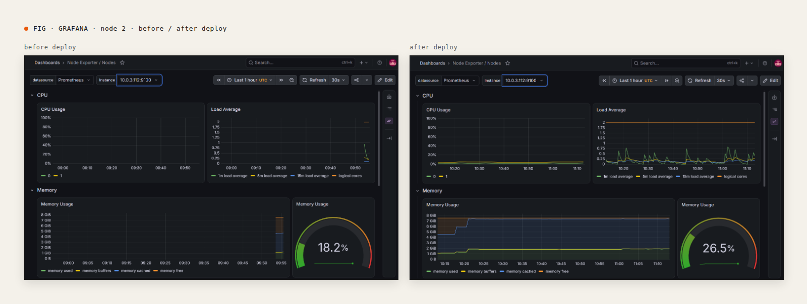<br/>Worker node 2, before and after the app.</td></tr>
</table>

## Components

### Terraform ([terraform/](terraform/))

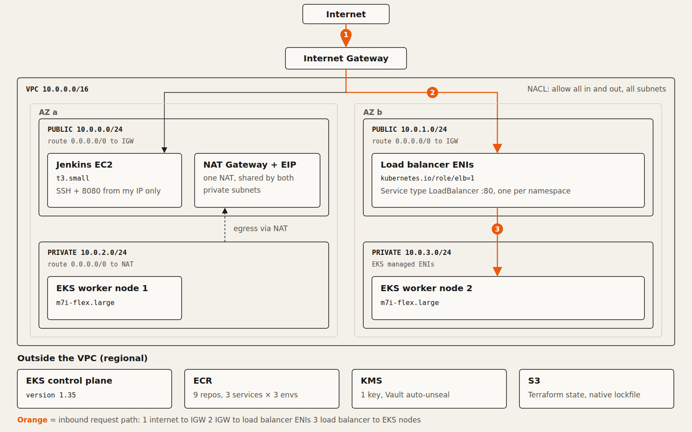

One stack with 4 modules, shared by all environments.

| Module | Creates |
| --- | --- |
| `network` | VPC `10.0.0.0/16`, 2 public + 2 private subnets, IGW, 1 NAT + EIP, route tables, permissive NACL, ELB subnet tags |
| `ec2` | The Jenkins instance: `t3.small`, 30 GiB encrypted gp3, IMDSv2 required, SSH and port 8080 only from `ssh_cidr_blocks`, IAM role `AmazonEC2ContainerRegistryPowerUser` |
| `ecr` | 9 repos from `setproduct(services, environments)` (`frontend-dev` ...): scan on push, AES256, MUTABLE tags |
| `eks` | Cluster 1.35 (private + public endpoint), 2 fixed ON_DEMAND nodes, IAM roles, add-ons (vpc-cni with network policy, Pod Identity agent, EBS CSI), Vault KMS key + role + Pod Identity association |

State is in S3 with a native lockfile. The bucket name (it contains the account ID) is passed at init through the git-ignored `backend.hcl`.

### Ansible ([ansible/](ansible/))

The dynamic inventory (`amazon.aws.aws_ec2`) matches tag `Name=ivolve-ec2-instance` in state `running`, which is the one Jenkins host. [playbook.yml](ansible/playbook.yml) updates packages, then runs 3 roles:

* `jenkins`: git, Corretto 21, Jenkins stable repo and GPG key, install, enable.
* `docker`: install, enable, add `jenkins` to the `docker` group, restart Jenkins to apply it.
* `trivy`: release rpm 0.58.0 (GPG check off, the rpm is unsigned).

### Jenkins ([Jenkinsfile](Jenkinsfile), [jenkins/shared-library/vars/](jenkins/shared-library/vars/))

One pipeline, parameter `ENV` (dev, stg, prod). The shared library provides `buildImage`, `testImage`, `pushImage`.

| # | Stage | What it does |
| --- | --- | --- |
| 1 | Checkout | Clones branch `params.ENV` over https (public repo, no credential). `IMAGE_TAG` = build number. Registry host comes from `aws sts get-caller-identity`, so no account ID in the file. |
| 2 | Build | `buildImage`: `docker build` per service, tagged `<registry>/<service>-<ENV>:<build>`. |
| 3 | Test | `testImage`: `trivy image --exit-code 0 --ignore-unfixed --severity HIGH,CRITICAL` with `TMPDIR=$HOME/trivy-tmp`. Findings are printed in the log; the build continues. |
| 4 | Push | `pushImage`: ECR login with the instance IAM role, `docker push`. |
| 5 | Update deploy branch | Rewrites `imageTag: "<build>"` in `values-<ENV>.yaml`, commits as `jenkins`, pushes to branch `<ENV>` with credential `github-https`. |

### Helm chart ([helm/ivolve/](helm/ivolve/))

One release per environment namespace: Deployments for frontend, auth and roadmap, StatefulSet for MySQL (5Gi gp3 PVC), a LoadBalancer Service for the frontend, ServiceAccounts, NetworkPolicies. App containers run as non-root with all capabilities dropped, no privilege escalation and the default seccomp profile (MySQL excepted: its entrypoint starts as root). Base `values.yaml` sets 2 replicas; dev and stg override to 1.

| Pod | Accepts traffic from | Port | CPU req / limit | Memory req / limit |
| --- | --- | --- | --- | --- |
| frontend | anywhere (load balancer) | 3000 | 50m / 250m | 64Mi / 256Mi |
| auth | frontend pods only | 5000 | 50m / 250m | 64Mi / 256Mi |
| roadmap | frontend pods only | 8080 | 100m / 500m | 256Mi / 512Mi |
| mysql | auth pods only | 3306 | 100m / 500m | 256Mi / 1Gi |

Ingress is denied by default in each namespace and opened only as above; egress is open (DNS, Vault agent). Policies are enforced because Terraform enables `enableNetworkPolicy` on the VPC CNI. Vault runs at 50m / 250m CPU and 128Mi / 256Mi memory.

### Argo CD ([argo/applications/](argo/applications/))

Three Applications, one per environment. The registry host is not in git: each Application passes `registry=${ECR_REGISTRY}`, filled by `envsubst` at `kubectl apply`.

| Env | Git branch | Sync | Namespace | ECR repos |
| --- | --- | --- | --- | --- |
| dev | `dev` | automatic, prune, self-heal | `ivolve-dev` | `*-dev` |
| stg | `stg` | automatic, prune, self-heal | `ivolve-stg` | `*-stg` |
| prod | `prod` | manual | `ivolve-prod` | `*-prod` |

Until an environment's first Jenkins run, `values-<env>.yaml` holds `imageTag: "0"` and pods stay in `ImagePullBackOff`.

### Vault ([helm/vault/](helm/vault/))

Standalone Vault (2Gi gp3) in namespace `vault`, auto-unsealed with the Terraform-created KMS key through Pod Identity, with the Agent Injector. [setup.sh](helm/vault/setup.sh) runs once: `operator init`, enable KV v2 at `secret/`, enable Kubernetes auth, policy `ivolve` (read `secret/data/ivolve/*`), role `ivolve` for ServiceAccounts `frontend`, `auth`, `mysql` in `ivolve-dev|stg|prod` (ttl 1h). Pods carry `vault.hashicorp.com/agent-inject*` annotations; the injected sidecar renders `/vault/secrets/db` or `/frontend`, and the container command sources it (`. /vault/secrets/db && exec <app>`) so the secrets become env vars. All 3 environments read the same secrets.

| Secret path | Keys | Used by |
| --- | --- | --- |
| `secret/ivolve/db` | `user`, `password`, `root_password`, `name` | auth, mysql |
| `secret/ivolve/frontend` | `session_secret` | frontend |

### Monitoring ([helm/monitoring/](helm/monitoring/))

kube-prometheus-stack in namespace `monitoring`: Prometheus (7d retention, 10Gi), Grafana (2Gi, ClusterIP, reached by `port-forward`), Alertmanager off. The Grafana screenshots above compare node load before and after the app was deployed.

### Application ([app/](app/))

| Service | Stack | Port | Role |
| --- | --- | --- | --- |
| frontend | Node 22, Express 5, EJS, express-session | 3000 | Web UI, session cookie, calls the two backends |
| auth-service | Python 3.12, Flask 3.1, bcrypt, gunicorn | 5000 | Sign up, log in, creates `users` table on demand |
| roadmap-service | Java 21, Spring Boot 3.5 | 8080 | Serves the 8-item DevOps roadmap |
| mysql | MySQL 8.0 | 3306 | `users(id, username UNIQUE, password_hash, created_at)` |

| Service | Method and path | Success | Errors |
| --- | --- | --- | --- |
| auth | `POST /api/auth/signup` `{username, password}` | 201 | 400 (username < 3 or password < 8 chars), 409 duplicate, 503 DB |
| auth | `POST /api/auth/login` `{username, password}` | 200 + `user` | 401 bad credentials, 503 DB |
| auth | `GET /health` | 200 `{"status":"UP"}` | 503 when DB unreachable |
| roadmap | `GET /api/roadmap` | 200, list of `{title, description}` | n/a |

Run locally with `cd app && docker compose up --build` (http://localhost:3000). Details: [app/README.md](app/README.md).

## What stays out of git

| Item | Where it lives instead |
| --- | --- |
| Your public IP (SSH and EKS API allow-list) | `terraform/terraform.tfvars` (git-ignored); template `terraform.tfvars.example` |
| AWS account ID in the state bucket name | `terraform/backend.hcl` (git-ignored); template `backend.hcl.example` |
| AWS account ID in the registry host | Jenkins: `aws sts get-caller-identity` at run time. Argo: `registry=${ECR_REGISTRY}` via `envsubst` |
| Vault root token and recovery keys | `helm/vault/vault-init.json` (git-ignored) |
| DB passwords, session secret | Vault |
| GitHub token for the `imageTag` push | Jenkins credential `github-https` |
| Terraform state | S3 (`*.tfstate` also git-ignored) |

## Decisions and lessons

* **Jenkins never touches the cluster.** It builds, scans, pushes and edits `imageTag`. Argo CD deploys, so cluster credentials never sit on the CI host.
* **Branch per environment.** `dev`, `stg`, `prod` each hold their own `imageTag`; promotion is a branch and a build, and prod needs a manual sync.
* **Trivy is report-only, on purpose.** Exit code 0 with `--ignore-unfixed --severity HIGH,CRITICAL`. With a blocking exit code, unfixed base-image CVEs failed every build. The trade-off: findings are logged, not enforced.
* **Build history (stage view above).**
  * #1-#2 failed at Build: the `jenkins` user had no Docker socket permission. Fix: add it to the `docker` group, now done in the Ansible `docker` role, which also restarts Jenkins.
  * #3-#4 failed at Test: the Trivy Java DB overflowed the 2 GiB RAM-backed `/tmp` on the host, and the exit code was blocking. Fix: `TMPDIR=$HOME/trivy-tmp` and `--exit-code 0`.
  * #5 passed end to end in about 1 minute.

## Deployment runbook

Prerequisites: AWS CLI, Terraform >= 1.10, Ansible with `amazon.aws`, `kubectl`, `helm`, `jq`, `envsubst`, EC2 key pair `ivolve-key`, the S3 state bucket.

1. **Publish branches.** Merge `main` into `dev`, `stg`, `prod` and run `git push -u origin main dev stg prod`.
2. **Infrastructure**
   ```bash
   cd terraform
   cp terraform.tfvars.example terraform.tfvars      # put your IP in
   cp backend.hcl.example backend.hcl                # put your account ID in
   terraform init -backend-config=backend.hcl
   terraform apply
   ```
3. **Jenkins host**
   ```bash
   cd ansible && ansible-playbook playbook.yml
   ```
   Open `http://<jenkins_public_ip>:8080`. Install the Pipeline, Git and Credentials Binding plugins, add credential `github-https` (username + GitHub token with push rights), register the library (name `ivolve-shared-library`, this repo over https, default version `main`, path `jenkins/shared-library`), create a pipeline job from this repo's `Jenkinsfile`.
4. **Cluster access and storage**
   ```bash
   aws eks update-kubeconfig --region eu-west-1 --name $(terraform -chdir=terraform output -raw eks_cluster_name)
   kubectl apply -f helm/gp3-storageclass.yaml
   ```
5. **Vault** (before the app)
   ```bash
   helm repo add hashicorp https://helm.releases.hashicorp.com
   helm install vault hashicorp/vault -n vault --create-namespace -f helm/vault/values.yaml \
     --set server.extraEnvironmentVars.VAULT_AWSKMS_SEAL_KEY_ID=$(terraform -chdir=terraform output -raw vault_kms_key_id)
   export DB_PASSWORD=... DB_ROOT_PASSWORD=... SESSION_SECRET=...
   bash helm/vault/setup.sh
   ```
6. **Monitoring**
   ```bash
   helm repo add prometheus-community https://prometheus-community.github.io/helm-charts
   helm install monitoring prometheus-community/kube-prometheus-stack -n monitoring \
     --create-namespace -f helm/monitoring/values.yaml --set grafana.adminPassword=...
   ```
7. **Argo CD** (upstream install, not stored in this repo)
   ```bash
   kubectl create namespace argocd
   kubectl apply -n argocd --server-side --force-conflicts -f https://raw.githubusercontent.com/argoproj/argo-cd/stable/manifests/install.yaml
   for e in dev stg prod; do envsubst < argo/applications/ivolve-$e.yaml | kubectl apply -f -; done
   ```
8. **First release.** Run the Jenkins job with `ENV=dev`, then `stg`, then `prod`. Argo syncs dev and stg itself; sync prod with the Argo UI or `argocd app sync ivolve-prod`.
9. **Get a URL and open Grafana**
   ```bash
   kubectl -n ivolve-dev get svc frontend -o jsonpath='{.status.loadBalancer.ingress[0].hostname}'
   kubectl -n monitoring port-forward svc/monitoring-grafana 3000:80
   ```

## Repository layout

`Jenkinsfile` and `jenkins/shared-library/vars/` (pipeline), `argo/applications/` (3 Applications), `helm/{ivolve,vault,monitoring}` plus `gp3-storageclass.yaml`, `terraform/modules/{network,ec2,ecr,eks}`, `ansible/roles/{jenkins,docker,trivy}`, `app/{frontend,auth-service,roadmap-service}` with `docker-compose.yaml`, `docs/` (site and images).
