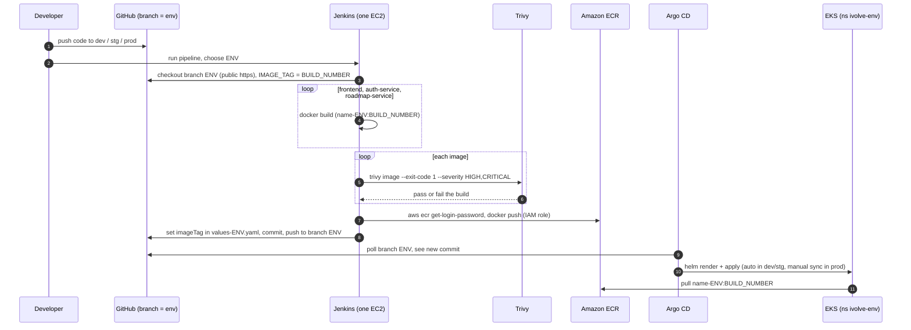

<p align="center">
  
  &nbsp;&nbsp;&nbsp;&nbsp;
  
</p>

<h1 align="center">iVolve DevOps Final Project</h1>

<p align="center">
  A three-service web app (login + DevOps roadmap) delivered end to end:<br/>
  Terraform on AWS &rarr; Ansible-built Jenkins &rarr; Trivy-gated image builds into ECR &rarr; Argo CD GitOps onto one EKS cluster &rarr; Vault secrets &rarr; Prometheus/Grafana monitoring.
</p>

---

## Table of contents

1. [What this project is](#1-what-this-project-is)
2. [Full architecture](#2-full-architecture)
3. [AWS network and infrastructure](#3-aws-network-and-infrastructure)
4. [CI/CD flow](#4-cicd-flow)
5. [Inside the Kubernetes cluster](#5-inside-the-kubernetes-cluster)
6. [Secrets flow (Vault)](#6-secrets-flow-vault)
7. [The application](#7-the-application)
8. [Repository layout](#8-repository-layout)
9. [Component reference](#9-component-reference)
10. [What stays out of git](#10-what-stays-out-of-git)
11. [Deployment runbook](#11-deployment-runbook)

---

## 1. What this project is

| Layer | Tooling | Where in the repo |
| --- | --- | --- |
| Application | Node.js frontend, Python auth service, Java roadmap service, MySQL | [app/](app/) |
| Local run | Docker Compose | [app/docker-compose.yaml](app/docker-compose.yaml) |
| Infrastructure as Code | Terraform (VPC, 1 EC2, 1 ECR with 9 repos, 1 EKS, KMS), S3 remote state | [terraform/](terraform/) |
| Configuration management | Ansible (git, Jenkins, Docker, Trivy on the EC2 host) | [ansible/](ansible/) |
| CI | One Jenkins host, one parameterised pipeline (`ENV`) + shared library | [Jenkinsfile](Jenkinsfile), [jenkins/](jenkins/) |
| Image security | Trivy (fails the build on HIGH/CRITICAL) | [jenkins/shared-library/vars/testImage.groovy](jenkins/shared-library/vars/testImage.groovy) |
| Registry | Amazon ECR, repos `<service>-<env>` | [terraform/modules/ecr/](terraform/modules/ecr/) |
| CD (GitOps) | One Argo CD, one Application per environment | [argo/applications/](argo/applications/) |
| Packaging | Helm chart | [helm/ivolve/](helm/ivolve/) |
| Secrets | HashiCorp Vault (KMS auto-unseal) + Agent Injector | [helm/vault/](helm/vault/) |
| Monitoring | kube-prometheus-stack (Prometheus + Grafana) | [helm/monitoring/](helm/monitoring/) |

The app: a user signs up and logs in, then sees a DevOps roadmap (OS, SCM, Containerization, Orchestration, CI/CD, Cloud, IaC, Configuration Management).

**One of everything shared, three of everything environment-specific:**

| Shared (one) | Per environment (dev, stg, prod) |
| --- | --- |
| AWS VPC, EKS cluster, Jenkins EC2, Argo CD, Vault, monitoring, ECR registry | git branch, Argo Application, namespace `ivolve-<env>`, 3 ECR repos (`frontend-dev`, ...), Helm values file |

---

## 2. Full architecture

End-to-end view: who talks to whom, from a `git push` to a pod serving a browser.

```text
                                      ┌────────────────┐
                                      │   Developer    │
                                      └───────┬────────┘
                                              │ git push (branch dev | stg | prod)
                                              ▼
 ┌──────────────────────────────────────────────────────────────────────────────────────────┐
 │                         GitHub (public repo, plain https)                                │
 │   main            dev                    stg                    prod                     │
 │   (source)   helm/ivolve/values-dev   values-stg             values-prod                  │
 │              imageTag: "<N>"          imageTag: "<N>"        imageTag: "<N>"             │
 └───────▲───────────────┬──────────────────────────────────────────────▲───────────────────┘
         │               │ 1. checkout branch = ENV (no credential)      │ 5. commit + push (PAT credential)
         │               ▼                                               │    "ci(ENV): deploy build N"
         │   ┌──────────────────────────────────────────────┐            │    (only edits imageTag)
         │   │   Jenkins  (ONE EC2, public subnet, AL2023)  │────────────┘
         │   │   one Jenkinsfile, parameter ENV             │
         │   │   2. buildImage  docker build  x3            │        ┌──────────────────────────┐
         │   │   3. testImage   trivy image (HIGH,CRITICAL) │        │  Amazon ECR  (9 repos)   │
         │   │   4. pushImage   docker push  ───────────────┼───────►│  frontend-<env>          │
         │   │   tag = BUILD_NUMBER; auth: EC2 IAM role     │        │  auth-service-<env>      │
         │   └──────────────────────────────────────────────┘        │  roadmap-service-<env>   │
         │                                                           └────────────┬─────────────┘
         │  6. Argo CD polls branch ENV, renders helm/ivolve                       │ 8. kubelet pulls image
         │     with values.yaml + values-ENV.yaml                                  │    (node role: ECR read-only)
 ┌───────┴────────────────────────────────────────────────────────────────────────┼─────────────┐
 │                                    AWS  eu-west-1                              │             │
 │  ┌───────────────────────────────────────────────────────────────────────────┐ │             │
 │  │  ONE EKS cluster (private subnets, 2 x m7i-flex.large, public API = my IP)│ │             │
 │  │                                                                           ▼ │             │
 │  │  ns argocd      ONE Argo CD ── 7. apply (auto-sync dev/stg, manual prod)    │             │
 │  │                                                                             │             │
 │  │  ns ivolve-dev  | ns ivolve-stg  | ns ivolve-prod   (same layout in each)   │             │
 │  │    frontend x2 ──► auth x2 ──► mysql (StatefulSet, EBS gp3 5Gi)             │             │
 │  │         └────────► roadmap x2                                               │             │
 │  │    NetworkPolicies + resource limits; Vault Agent sidecar for secrets       │             │
 │  │                                                                             │             │
 │  │  ns vault       Vault (standalone, KMS auto-unseal) + Agent Injector        │             │
 │  │  ns monitoring  Prometheus (7d, 10Gi) + Grafana (2Gi)                       │             │
 │  │  kube-system    EBS CSI driver, Pod Identity agent, VPC CNI (netpol on)     │             │
 │  └─────────────────────────────────────────────────────────────────────────────┘             │
 │        ▲ Service type LoadBalancer :80 per namespace (public subnets)    KMS key (Vault)     │
 └────────┼─────────────────────────────────────────────────────────────────────────────────────┘
          │
   ┌──────┴──────┐
   │   Browser   │
   └─────────────┘

 Terraform state:  S3 bucket (name has the account ID, kept out of git), key terraform.tfstate, native lockfile
 Ansible:          configures the one Jenkins EC2 host over SSH (git, java, jenkins, docker, trivy)
```

Key design rules:

* **Jenkins never touches the cluster.** It builds, scans, pushes, and edits `imageTag` in git. Argo CD does the deploy.
* **Git is the source of truth.** The deployed image tag is whatever the environment branch says. Tags are Jenkins build numbers.
* **No secrets or account details in git.** DB credentials and the session secret live in Vault. The AWS account ID and your IP stay in git-ignored files or are computed at run time (section 10).

---

## 3. AWS network and infrastructure

Terraform creates **one** stack, used by all three environments.

```text
                                         Internet
                                             │
                                  ┌──────────┴──────────┐
                                  │  Internet Gateway   │
                                  └──────────┬──────────┘
 ┌───────────────────────────────────────────┼─────────────────────────────────────────────┐
 │ VPC 10.0.0.0/16   (DNS hostnames on)      │         NACL: allow all in/out (all subnets) │
 │                                           │                                             │
 │  ┌─────────────── AZ a ───────────────┐   │   ┌─────────────── AZ b ───────────────┐    │
 │  │ PUBLIC  10.0.0.0/24                │◄──┴──►│ PUBLIC  10.0.1.0/24                │    │
 │  │  route 0.0.0.0/0 -> IGW            │       │  route 0.0.0.0/0 -> IGW            │    │
 │  │  ┌────────────────────────┐        │       │  tag kubernetes.io/role/elb=1      │    │
 │  │  │ EC2 Jenkins (t3.small) │        │       │   (load balancer ENIs land here)   │    │
 │  │  │ 30 GiB gp3, encrypted  │        │       └────────────────────────────────────┘    │
 │  │  │ SG: 22+8080 from my IP │        │                                                 │
 │  │  │ IMDSv2 required        │        │                                                 │
 │  │  │ role: ECR PowerUser    │        │                                                 │
 │  │  └────────────────────────┘        │                                                 │
 │  │  ┌────────────────────────┐        │                                                 │
 │  │  │ NAT Gateway + EIP      │        │   (single NAT, shared by both private subnets)  │
 │  │  └───────────┬────────────┘        │                                                 │
 │  └──────────────┼─────────────────────┘                                                 │
 │                 │ private route 0.0.0.0/0 -> NAT                                         │
 │  ┌──────────────▼──── AZ a ───────────┐       ┌─────────────── AZ b ───────────────┐    │
 │  │ PRIVATE 10.0.2.0/24                │       │ PRIVATE 10.0.3.0/24                │    │
 │  │  EKS worker node 1                 │       │  EKS worker node 2                 │    │
 │  │  tag role/internal-elb=1           │       │  EKS managed ENIs                  │    │
 │  └────────────────────────────────────┘       └────────────────────────────────────┘    │
 └─────────────────────────────────────────────────────────────────────────────────────────┘

 Outside the VPC (regional):
   EKS control plane  version 1.35, private + public endpoint (public limited to eks_public_access_cidrs)
   ECR                9 repositories (3 services x 3 envs), scan_on_push, AES256, MUTABLE tags
   KMS                1 key (rotation on) for Vault auto-unseal
   IAM                jenkins role/profile, eks cluster role, eks node role, ebs-csi role, vault role (Pod Identity)
   EKS add-ons        vpc-cni (network policy enabled), eks-pod-identity-agent, aws-ebs-csi-driver
```

### Terraform module map

```text
terraform/
├── main.tf ───────────────► wires modules together
│     ├── module "network" ─► VPC, 2 public + 2 private subnets, IGW, NAT, route tables, NACL
│     ├── module "ec2"     ─► the one Jenkins instance, its security group, IAM role + instance profile
│     ├── module "ecr"     ─► repos from setproduct(services, environments): frontend-dev, frontend-stg, ...
│     └── module "eks"     ─► cluster, node group (2 fixed), IAM roles, add-ons, Vault KMS key + role + Pod Identity
├── provider.tf ───────────► aws ~> 6.0; S3 backend, bucket supplied at init (backend.hcl, git-ignored)
├── terraform.tfvars.example ► copy to terraform.tfvars (git-ignored)
└── backend.hcl.example ───► copy to backend.hcl (git-ignored)
```

---

## 4. CI/CD flow



### Pipeline stages ([Jenkinsfile](Jenkinsfile))

| # | Stage | What it does |
| --- | --- | --- |
| 1 | Checkout | Clones branch `params.ENV` over https (public repo, no credential). `IMAGE_TAG` = Jenkins build number. The registry host is computed from `aws sts get-caller-identity`, so the account ID is not in the file. |
| 2 | Build | `buildImage` runs `docker build` for each service, tagged `<registry>/<service>-<ENV>:<build>`. |
| 3 | Test | `testImage` runs `trivy image --exit-code 1 --ignore-unfixed --severity HIGH,CRITICAL`. A HIGH/CRITICAL finding that has a fix stops the pipeline; unfixed base-image CVEs do not. |
| 4 | Push | `pushImage` logs in to ECR with the instance IAM role and pushes. |
| 5 | Update deploy branch | Rewrites `imageTag: "<build>"` in `helm/ivolve/values-<ENV>.yaml`, commits as `jenkins`, pushes to branch `<ENV>` using the `github-https` credential (a GitHub token with write access). |

The shared library lives in [jenkins/shared-library/vars/](jenkins/shared-library/vars/) (`buildImage`, `testImage`, `pushImage`).

### Promotion model

| Env | Git branch | Argo sync | Namespace | ECR repos |
| --- | --- | --- | --- | --- |
| dev | `dev` | automatic, prune, self-heal | `ivolve-dev` | `*-dev` |
| stg | `stg` | automatic, prune, self-heal | `ivolve-stg` | `*-stg` |
| prod | `prod` | **manual** | `ivolve-prod` | `*-prod` |

Until the first Jenkins run for an environment, `values-<env>.yaml` holds the placeholder `imageTag: "0"`; pods stay in `ImagePullBackOff` until Jenkins pushes build 1 and updates the file.

---

## 5. Inside the Kubernetes cluster

One release of the [ivolve Helm chart](helm/ivolve/) per environment namespace:

```text
                              Internet
                                  │
                       ┌──────────▼───────────┐
                       │ Service "frontend"   │  type LoadBalancer, :80 -> 3000
                       │ sessionAffinity:     │  same browser -> same pod
                       │ ClientIP (1h)        │
                       └──────────┬───────────┘
                                  │
        ┌─────────────────────────▼─────────────────────────┐
        │ Deployment frontend (x2)   SA: frontend           │
        │  Node.js / Express / EJS, express-session         │
        │  env: AUTH_SERVICE_URL=http://auth:5000           │
        │       ROADMAP_SERVICE_URL=http://roadmap:8080     │
        │  Vault secret: SESSION_SECRET                     │
        └───────────┬─────────────────────────┬─────────────┘
                    │ HTTP                    │ HTTP
        ┌───────────▼─────────────┐   ┌───────▼───────────────────┐
        │ Service "auth" :5000    │   │ Service "roadmap" :8080   │
        └───────────┬─────────────┘   └───────┬───────────────────┘
                    │                         │
        ┌───────────▼─────────────┐   ┌───────▼───────────────────┐
        │ Deployment auth (x2)    │   │ Deployment roadmap (x2)   │
        │  Python / Flask         │   │  Java 21 / Spring Boot    │
        │  SA: auth               │   │  GET /api/roadmap         │
        │  readiness: GET /health │   │  static data, no DB       │
        │  Vault secret: DB creds │   │  no Vault                 │
        └───────────┬─────────────┘   └───────────────────────────┘
                    │ MySQL :3306
        ┌───────────▼─────────────┐
        │ Service "mysql"         │  headless (clusterIP: None)
        └───────────┬─────────────┘
        ┌───────────▼─────────────┐
        │ StatefulSet mysql (x1)  │  SA: mysql, image mysql:8.0
        │  Vault secret: DB creds │
        │  PVC 5Gi, class gp3     │──► EBS gp3 volume (EBS CSI driver), mounted with subPath
        └─────────────────────────┘
```

### Network policies and limits

App containers run as a non-root numeric UID with all capabilities dropped, no privilege escalation and the default seccomp profile ([_helpers.tpl](helm/ivolve/templates/_helpers.tpl)). MySQL is excluded because its entrypoint starts as root. Auth runs under gunicorn.

Ingress is denied by default in each `ivolve-<env>` namespace and opened only along the arrows above ([networkpolicy.yaml](helm/ivolve/templates/networkpolicy.yaml)):

| Pod | Accepts traffic from | Port |
| --- | --- | --- |
| frontend | anywhere (load balancer) | 3000 |
| auth | frontend pods only | 5000 |
| roadmap | frontend pods only | 8080 |
| mysql | auth pods only | 3306 |

Egress is left open (DNS, and the Vault Agent must reach Vault). Policies are enforced because Terraform turns on `enableNetworkPolicy` in the VPC CNI add-on.

| Pod | CPU request / limit | Memory request / limit |
| --- | --- | --- |
| frontend | 50m / 250m | 64Mi / 256Mi |
| auth | 50m / 250m | 64Mi / 256Mi |
| roadmap | 100m / 500m | 256Mi / 512Mi |
| mysql | 100m / 500m | 256Mi / 1Gi |
| vault | 50m / 250m | 128Mi / 256Mi |

Cluster-wide add-ons (outside the app chart):

| Namespace | Component | Config |
| --- | --- | --- |
| `kube-system` | VPC CNI, EBS CSI driver, Pod Identity agent | EKS add-ons from Terraform |
| `kube-system` | StorageClass `gp3` (default) | [helm/gp3-storageclass.yaml](helm/gp3-storageclass.yaml), WaitForFirstConsumer, expandable |
| `vault` | Vault standalone, 2Gi gp3, injector, UI (ClusterIP) | [helm/vault/values.yaml](helm/vault/values.yaml) |
| `monitoring` | Prometheus (7d retention, 10Gi), Grafana (2Gi, ClusterIP), Alertmanager off | [helm/monitoring/values.yaml](helm/monitoring/values.yaml) |
| `argocd` | Argo CD + the 3 Application objects | [argo/applications/](argo/applications/) |

---

## 6. Secrets flow (Vault)

```text
   ONE TIME (helm/vault/setup.sh)                         EVERY POD START
   ─────────────────────────────                          ───────────────
   vault operator init (recovery keys, root token)        1. API server admits the pod; the Vault
   Vault auto-unseals with the AWS KMS key                   injector webhook sees the annotations
   enable KV v2 at  secret/                                  vault.hashicorp.com/agent-inject*
   enable kubernetes auth                                 2. Webhook adds an init container +
   policy "ivolve": read secret/data/ivolve/*                sidecar (Vault Agent)
   role "ivolve": SAs frontend,auth,mysql                 3. Agent logs in with the pod's
        in ns ivolve-dev|stg|prod, ttl 1h                    ServiceAccount token (role "ivolve")
   kv put secret/ivolve/db        user, password,         4. Agent renders the template to
          root_password, name                                /vault/secrets/db  (or /frontend)
   kv put secret/ivolve/frontend  session_secret          5. Container command:
                                                             . /vault/secrets/db && exec <app>
   AFTER ANY VAULT RESTART                                   so the secrets become env vars
   ───────────────────────
   Vault pod ─(Pod Identity role)─► KMS Decrypt ─► unsealed again, nothing to do by hand
```

| Secret path | Keys | Used by |
| --- | --- | --- |
| `secret/ivolve/db` | `user`, `password`, `root_password`, `name` | `auth`, `mysql` |
| `secret/ivolve/frontend` | `session_secret` | `frontend` |

All three environments read the same Vault secrets (same policy and role). `helm/vault/vault-init.json` (recovery keys + root token) is created locally by `setup.sh` and is git-ignored. Store it somewhere safe.

---

## 7. The application

### Services

| Service | Stack | Port | Role |
| --- | --- | --- | --- |
| frontend | Node 22, Express 5, EJS, express-session, axios | 3000 | Web UI, session cookie, calls the two backends |
| auth-service | Python 3.12, Flask 3.1, bcrypt, mysql-connector | 5000 | Sign up, log in, creates the `users` table on demand |
| roadmap-service | Java 21, Spring Boot 3.5 (multi-stage Maven build) | 8080 | Serves the 8-item roadmap list |
| mysql | MySQL 8.0 | 3306 | `users(id, username UNIQUE, password_hash, created_at)` |

### Request flow

```text
 Browser ──► GET /            frontend: logged in? redirect /roadmap : render login page
 Browser ──► POST /signup     frontend ──► POST auth:5000/api/auth/signup  ──► INSERT users (bcrypt hash)
 Browser ──► POST /login      frontend ──► POST auth:5000/api/auth/login   ──► SELECT + bcrypt check
                              success: session.user set, redirect /roadmap
 Browser ──► GET /roadmap     needs session; frontend ──► GET roadmap:8080/api/roadmap, renders roadmap.ejs
 Browser ──► POST /logout     session destroyed
 DB down ──► auth returns 503, frontend renders the "MySQL Connection Error" page
```

### HTTP APIs

| Service | Method and path | Success | Errors |
| --- | --- | --- | --- |
| auth | `POST /api/auth/signup` `{username, password}` | 201 | 400 (username < 3 or password < 8 chars), 409 duplicate, 503 DB |
| auth | `POST /api/auth/login` `{username, password}` | 200 + `user` | 401 bad credentials, 503 DB |
| auth | `GET /health` | 200 `{"status":"UP"}` | 503 when the DB is unreachable |
| roadmap | `GET /api/roadmap` | 200, JSON list of `{title, description}` | n/a |

### Run it locally

```bash
cd app
docker compose up --build        # http://localhost:3000
```

Compose isolates traffic on three networks: `app-auth` (frontend + auth), `db-auth` (auth + mysql), `app-roadmap` (frontend + roadmap). Only the frontend port is published. Defaults (`ivolve`/`ivolve`, session secret `change-me`) can be overridden with env vars. More detail: [app/README.md](app/README.md).

---

## 8. Repository layout

```text
.
├── Jenkinsfile                      CI pipeline (parameter ENV = dev | stg | prod)
├── jenkins/shared-library/vars/     buildImage, testImage (Trivy), pushImage (ECR)
├── argo/applications/               Argo CD Applications: ivolve-dev, -stg, -prod (registry via envsubst)
├── helm/
│   ├── ivolve/                      app chart: frontend, auth, roadmap, mysql, service accounts, network policies
│   │   ├── values.yaml              defaults (ports, replicas, limits, Vault templates; registry/imageTag empty)
│   │   └── values-{dev,stg,prod}.yaml   environment name + imageTag (Jenkins rewrites imageTag)
│   ├── vault/                       values.yaml (KMS auto-unseal) + setup.sh (init, auth, policy, secrets)
│   ├── monitoring/values.yaml       kube-prometheus-stack overrides
│   └── gp3-storageclass.yaml        default StorageClass for the EBS CSI driver
├── terraform/
│   ├── main.tf provider.tf variables.tf outputs.tf
│   ├── terraform.tfvars.example  backend.hcl.example     (real files are git-ignored)
│   └── modules/{network,ec2,ecr,eks}/
├── ansible/
│   ├── ansible.cfg inventory.aws_ec2.yml playbook.yml
│   └── roles/{jenkins,docker,trivy}/
└── app/
    ├── frontend/  auth-service/  roadmap-service/    (each has its own Dockerfile)
    └── docker-compose.yaml
```

---

## 9. Component reference

### Terraform

| Module | Creates | Notable settings |
| --- | --- | --- |
| network | VPC, 2 public + 2 private subnets (`cidrsubnet(vpc, 8, i)`), IGW, 1 NAT + EIP, route tables, permissive NACL | subnets tagged for ELB discovery |
| ec2 | the one Jenkins instance (AL2023 via SSM parameter), security group, IAM role `AmazonEC2ContainerRegistryPowerUser`, instance profile | `t3.small`, 30 GiB encrypted gp3 root disk, IMDSv2 required, SSH and Jenkins UI (8080) only from `ssh_cidr_blocks`, tag `Name=<project>-ec2-instance` |
| ecr | one repo per name passed in (`<service>-<env>`) | scan on push, AES256, MUTABLE, `force_delete=false` |
| eks | cluster, node group (fixed 2 nodes, ON_DEMAND), IAM roles, add-ons (vpc-cni with network policy, pod identity agent, EBS CSI), Vault KMS key + role + Pod Identity association | private + public endpoint |

### Ansible ([playbook.yml](ansible/playbook.yml))

The inventory (`amazon.aws.aws_ec2`) matches the tag `Name=ivolve-ec2-instance` in state `running`. Terraform makes exactly one such instance, so Ansible finds exactly the Jenkins host. The playbook updates all packages, then runs roles:

* `jenkins`: git, Corretto 21, Jenkins stable repo + GPG key, install, enable.
* `docker`: install, enable, add `jenkins` to the `docker` group, restart Jenkins to apply it.
* `trivy`: installs release rpm 0.58.0 (GPG check disabled because the rpm is unsigned).

### Helm values you will change most

| Key | Default | Meaning |
| --- | --- | --- |
| `registry` | empty | ECR registry host; set by the Argo Application parameter |
| `environment` | empty | `dev`, `stg` or `prod`; set in `values-<env>.yaml` |
| `imageTag` | empty | build number; Jenkins rewrites it in `values-<env>.yaml` |
| `*.replicas` | 2 (1 in dev and stg) | frontend, auth, roadmap |
| `*.resources` | see section 5 | requests and limits |
| `frontend.sessionAffinitySeconds` | 3600 | sticky window for the frontend Service |
| `networkPolicy.enabled` | `true` | ingress isolation |
| `vault.enabled` | `true` | turn off to skip the injector annotations |

---

## 10. What stays out of git

| Item | Where it lives instead |
| --- | --- |
| Your public IP (SSH and EKS API allow-list) | `terraform/terraform.tfvars` (git-ignored); template in `terraform.tfvars.example` |
| AWS account ID in the state bucket name | `terraform/backend.hcl` (git-ignored); template in `backend.hcl.example` |
| AWS account ID in the registry host (Jenkins) | computed at run time by `aws sts get-caller-identity` |
| AWS account ID in the registry host (Argo/Helm) | Argo Application parameter `registry=${ECR_REGISTRY}`, filled by `envsubst` when you `kubectl apply`; `values.yaml` has `registry: ""` |
| Vault root token and recovery keys | `helm/vault/vault-init.json` (git-ignored) |
| DB passwords, session secret | Vault |
| GitHub token for the `imageTag` push | Jenkins credential `github-https` |
| Terraform state | S3 (`*.tfstate` also git-ignored) |

The git history was recreated from scratch, so no earlier commit contains the IP or account ID.

---

## 11. Deployment runbook

Prerequisites: AWS CLI with credentials, Terraform >= 1.10, Ansible with the `amazon.aws` collection, `kubectl`, `helm`, `jq`, `envsubst`, an EC2 key pair named `ivolve-key`, and the S3 state bucket.

1. **Commit and publish the branches.** Commit the work on `main`, then merge `main` into `dev`, `stg` and `prod` and push all four (`git push -u origin main dev stg prod`). Argo and Jenkins read these branches from GitHub.
2. **Infrastructure** (one apply, one stack)
   ```bash
   cd terraform
   cp terraform.tfvars.example terraform.tfvars      # put your IP in
   cp backend.hcl.example backend.hcl                # put your account ID in
   terraform init -backend-config=backend.hcl
   terraform apply
   ```
3. **Jenkins host**
   ```bash
   cd ansible && ansible-playbook playbook.yml
   ```
   Then open `http://<jenkins_public_ip>:8080` (reachable only from your IP) and in Jenkins: install the Pipeline, Git and Credentials Binding plugins, add the `github-https` credential (username + GitHub token with push rights), register the library (name `ivolve-shared-library`, this repo over https, default version `main`, path `jenkins/shared-library`), and create a pipeline job from this repo's `Jenkinsfile`.
4. **Cluster access and storage**
   ```bash
   aws eks update-kubeconfig --region eu-west-1 --name $(terraform -chdir=terraform output -raw eks_cluster_name)
   kubectl apply -f helm/gp3-storageclass.yaml
   ```
5. **Vault** (before the app)
   ```bash
   helm repo add hashicorp https://helm.releases.hashicorp.com
   helm install vault hashicorp/vault -n vault --create-namespace -f helm/vault/values.yaml \
     --set server.extraEnvironmentVars.VAULT_AWSKMS_SEAL_KEY_ID=$(terraform -chdir=terraform output -raw vault_kms_key_id)
   export DB_PASSWORD=... DB_ROOT_PASSWORD=... SESSION_SECRET=...
   bash helm/vault/setup.sh
   ```
6. **Monitoring**
   ```bash
   helm repo add prometheus-community https://prometheus-community.github.io/helm-charts
   helm install monitoring prometheus-community/kube-prometheus-stack -n monitoring \
     --create-namespace -f helm/monitoring/values.yaml --set grafana.adminPassword=...
   ```
7. **Lint the chart** before Argo can sync it (needs helm; it was not linted where it was written)
   ```bash
   export ECR_REGISTRY=<account-id>.dkr.ecr.eu-west-1.amazonaws.com
   helm lint helm/ivolve -f helm/ivolve/values-dev.yaml --set registry=$ECR_REGISTRY
   helm template ivolve helm/ivolve -f helm/ivolve/values-dev.yaml --set registry=$ECR_REGISTRY > /dev/null
   ```
8. **Argo CD** (install command is the upstream one; it is not stored in this repo)
   ```bash
   kubectl create namespace argocd
   kubectl apply -n argocd -f https://raw.githubusercontent.com/argoproj/argo-cd/stable/manifests/install.yaml
   for e in dev stg prod; do envsubst < argo/applications/ivolve-$e.yaml | kubectl apply -f -; done
   ```
9. **First release**: run the Jenkins job with `ENV=dev`, then `stg`, then `prod`. Each run pushes `*-<env>:<build>` and updates `values-<env>.yaml`. Argo syncs dev and stg itself; sync prod by hand in the Argo UI or `argocd app sync ivolve-prod`.
10. **Get a URL**
   ```bash
   kubectl -n ivolve-dev get svc frontend -o jsonpath='{.status.loadBalancer.ingress[0].hostname}'
   ```
11. **Grafana**: `kubectl -n monitoring port-forward svc/monitoring-grafana 3000:80`.
